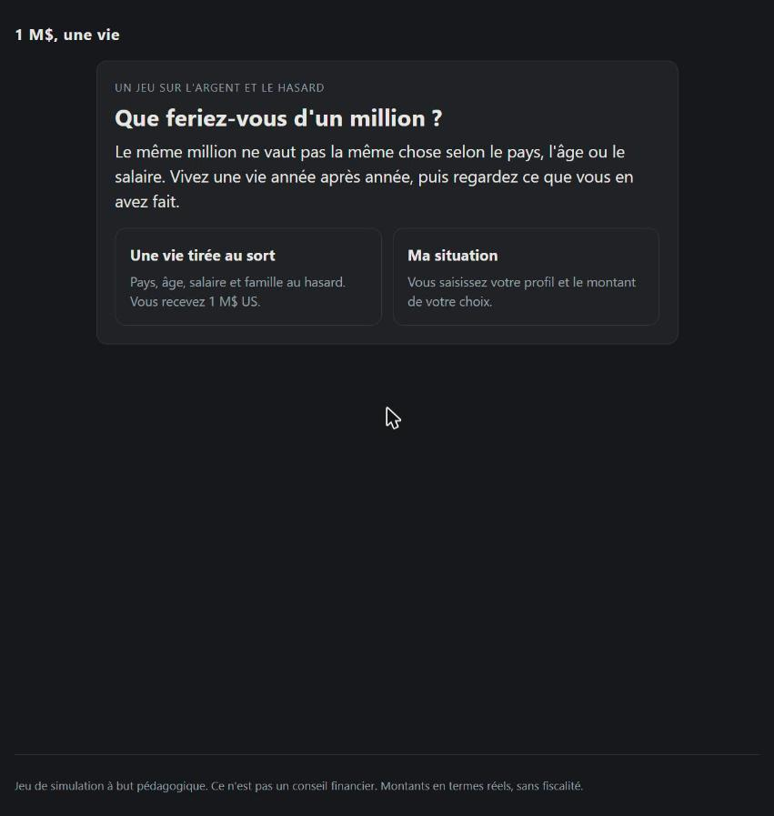
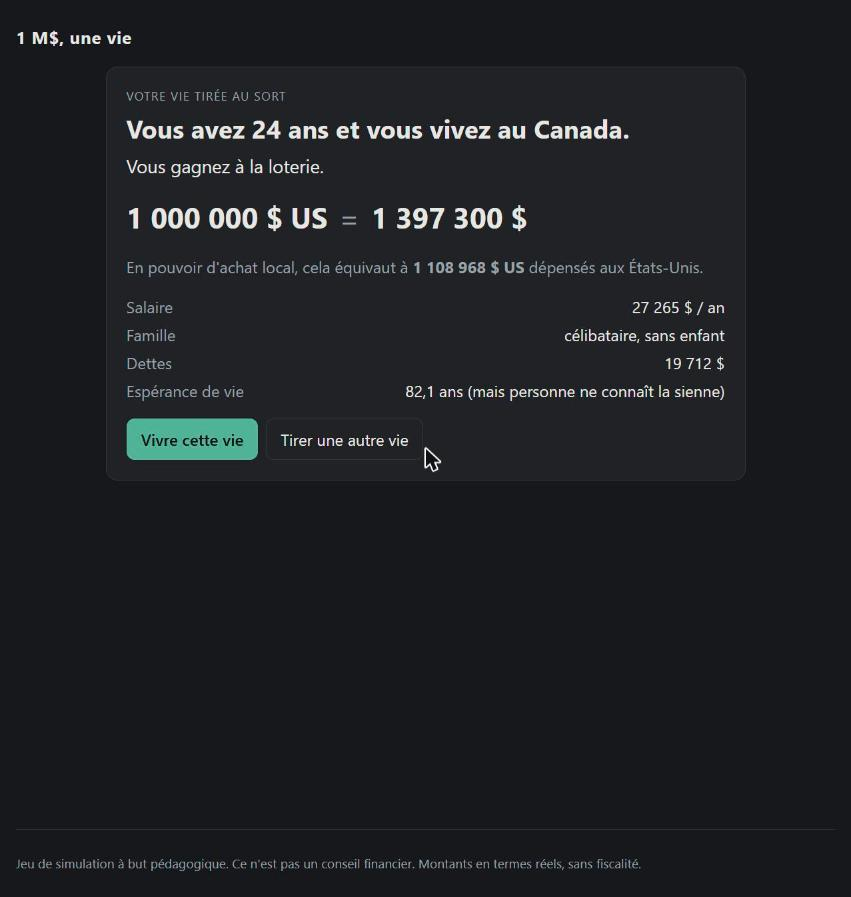
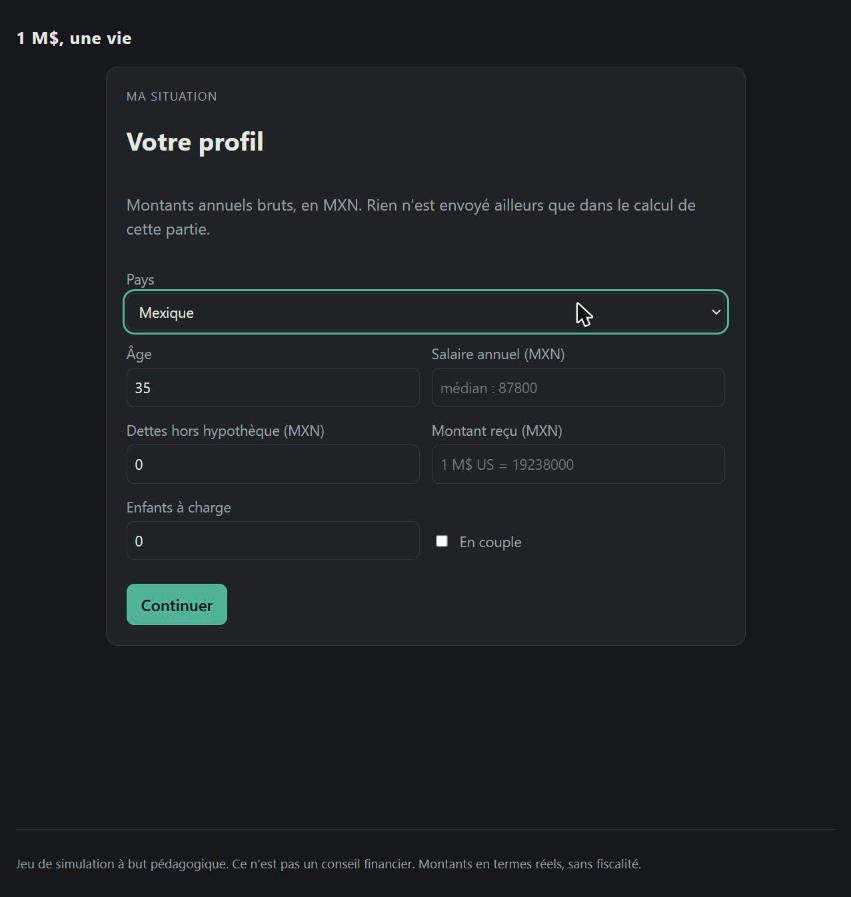
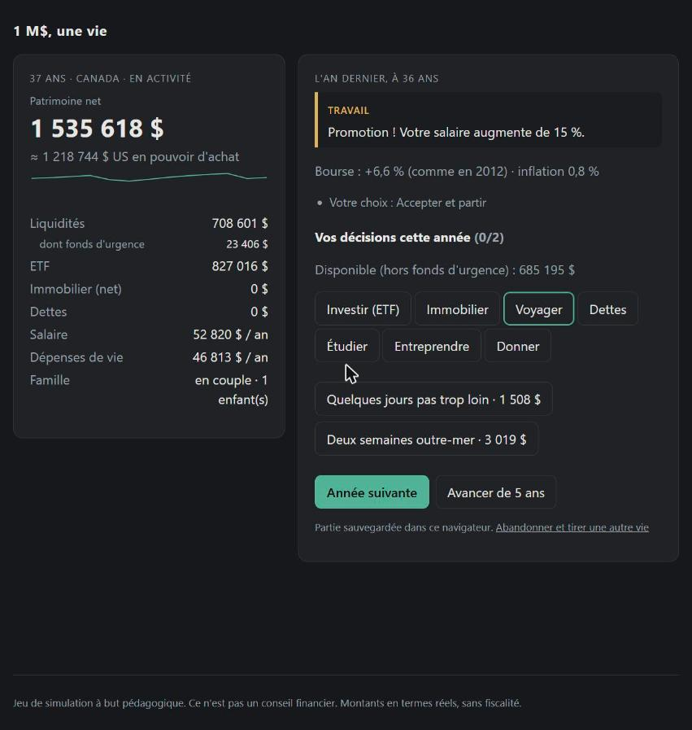
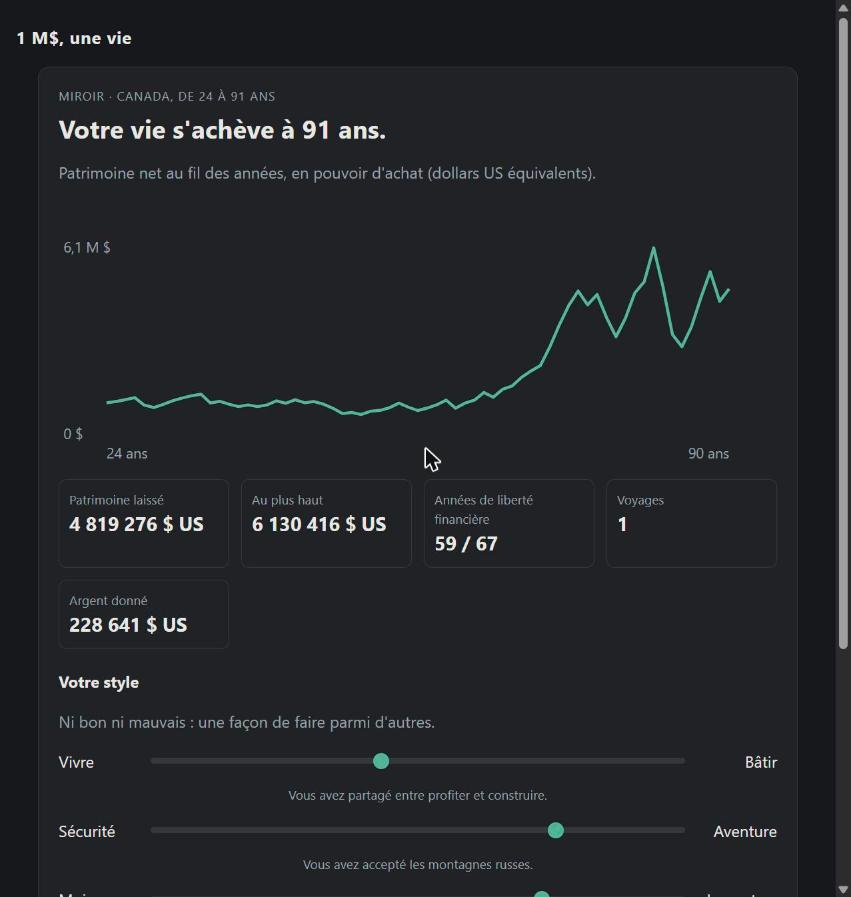
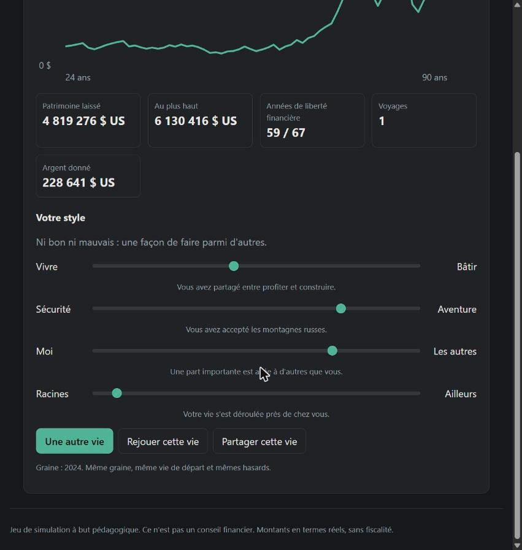

# Et si… ?

*1 M$, une vie*

Un jeu de simulation dans le navigateur. Vous recevez 1 M$ au cours d'une vie tirée au sort, ou un montant de votre choix dans votre propre situation, et vous décidez chaque année quoi en faire. À la fin, un miroir montre la trajectoire de votre patrimoine et votre « style ».

Le message du jeu : **1 M$ ne vaut pas la même chose pour tout le monde**.

> Jeu à but pédagogique. **Ce n'est pas un conseil financier.**

État actuel : **étape 3a**.
- **6 pays** : Canada, Brésil, France, Hong Kong, États-Unis, Mexique. Chacun a ses vrais marchés de 2002 à 2025.
- **Deux modes** :
  - *jeu* : une vie tirée au sort, avec 1 M$ US ;
  - *réaliste* : vous saisissez votre pays, votre âge, votre salaire, vos dettes, votre famille et le montant reçu.
- **7 briques** : investir, immobilier, voyager, rembourser ses dettes, étudier à l'étranger, entreprendre, donner.
- **43 événements.**
- **Miroir à 4 axes** : Vivre ↔ Bâtir, Sécurité ↔ Aventure, Moi ↔ Les autres, Racines ↔ Ailleurs.
- La partie en cours est sauvegardée dans le navigateur.

| Accueil | Tirage | Ma situation |
|---|---|---|
|  |  |  |

| Une année | Miroir | Les 4 axes |
|---|---|---|
|  |  |  |

## Lancer le jeu en local

Prérequis : Python 3.12 et Node 20 ou plus récent.

```bash
python -m venv .venv
.venv/Scripts/pip install -r requirements.txt    # sous Linux/macOS : .venv/bin/pip
.venv/Scripts/python -m uvicorn api.main:app --port 8000

cd web
npm install
npm run dev        # http://localhost:5173
```

Pour lancer les tests : `.venv/Scripts/python -m pytest`

Pour partager une vie, utilisez l'URL avec sa graine : `?seed=42`. Pour imposer un pays : `?seed=42&pays=CA`. En mode réaliste, le profil est aussi dans l'URL, donc un lien redonne la même vie.

## Déploiement (Render, offre gratuite)

Le fichier `render.yaml` décrit deux services : l'API (FastAPI) et le site statique (`web/dist`).
1. Sur Render : *New → Blueprint*, choisir le dépôt.
2. Une fois l'API créée, renseigner `VITE_API_URL` (site statique) avec l'adresse de l'API, et `ALLOWED_ORIGINS` (API) avec l'adresse du site, puis redéployer.

L'API gratuite s'endort après un moment d'inactivité : la première partie peut mettre environ 30 secondes à démarrer.

## Limites connues

- **Hong Kong** : 10 à 16 % des vies finissent en faillite, surtout à la retraite. La pension est estimée (≈ 30 % du salaire) et l'indice d'inégalité utilisé est celui des revenus des ménages avant transferts.
- Brésil et Mexique : les années de liberté financière sont saturées (98 à 100 %), car les liquidités y rapportent un taux réel élevé.
- Beaucoup de paramètres des pays les plus récents restent des estimations, listées dans [data/SOURCES.md](data/SOURCES.md).
- Pas de fiscalité en V1.

## Architecture

| Dossier | Rôle |
|---|---|
| `engine/` | Moteur en Python pur, déterministe, indépendant de l'API (réutilisable par le futur simulateur) |
| `api/` | FastAPI **sans état** : le client envoie la graine et la liste de ses décisions, le serveur rejoue la vie |
| `web/` | Interface React (Vite) |
| `data/` | Toutes les hypothèses chiffrées, avec leurs sources |
| `tests/` | pytest : déterminisme, partie complète dans les 6 pays, mode réaliste, briques, miroir, faillite, sources présentes |
| `tools/` | Construction de l'historique de marché, simulateur de stratégies (`python tools/simulate.py 100`) |

Principes du moteur :
- Montants en monnaie locale et **en termes réels**.
- Affichage aussi **en pouvoir d'achat (PPA)**.
- Chaque année de jeu **rejoue une année réelle du pays (2002-2025)** : bourse locale, inflation, taux, change et immobilier ensemble.
- L'aléa de chaque année dépend seulement de la graine et du numéro de l'année : une décision ne modifie jamais les tirages des années suivantes.

## Sources des données

Toutes les sources sont dans [data/SOURCES.md](data/SOURCES.md), avec la liste des valeurs qui restent des estimations. Les principales :
- **Marchés** : MSCI (actions locales, dividendes compris), instituts statistiques, Eurostat et Banque mondiale (inflation), OCDE/FRED et HKMA (taux), FRED (change), BRI (immobilier). Le Mexique commence en 2006, faute d'indice immobilier BRI avant 2005.
- **Pays** : Banque mondiale ; Statistique Canada, IBGE, INSEE, C&SD, BLS, INEGI ; Banque du Canada, Banco Central do Brasil, Banque de France, HKMA, Banco de México ; ACI/CREA, FipeZap, RVD, NAR, SHF, Freddie Mac ; Equifax, CNC, OCDE.
- **Règles de jeu et événements** : ce sont des choix de conception, chacun documenté dans son fichier.
